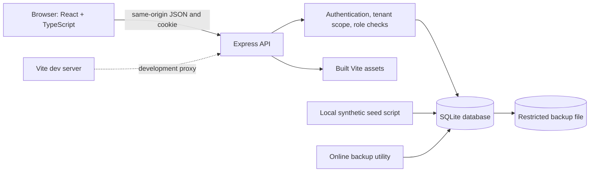
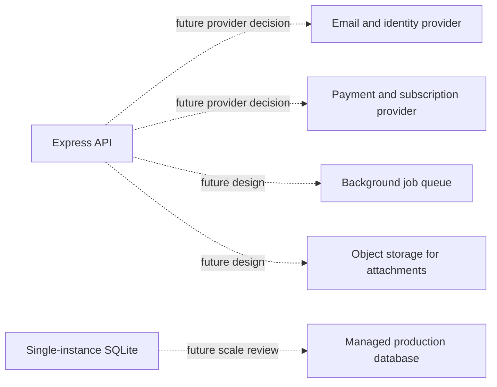

# Technical architecture diagram

## Current MVP runtime

## Planned integrations (not connected)

Dashed connections are roadmap concepts, not available integrations. There is no configured background worker, email delivery, payment processing, attachment store, or horizontally scaled deployment.
